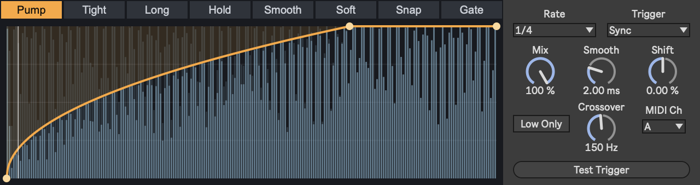

# PumpShaper

A tempo-synced volume ducker for Ableton Live, built as a Max for Live device.
Draw the shape of the dip, or pick a preset.



*The device running in Max with a test tone.*

- Curve editor with 8 presets and a live waveform
- Rates from 1 bar to 1/16, including dotted and triplet
- Tempo sync, or MIDI triggering from your own kick pattern
- Low-only mode with an adjustable crossover
- Mix, smoothing and timing shift

## Requirements

Ableton Live with Max for Live (included in Live Suite). Built and tried on
Live 12.4.16 (Max 9.1.5) on an Apple Silicon Mac. It uses `v8ui`, so it needs
Max 9. Other setups, including Windows, are untested.

## Install

1. Download the zip from [Releases](../../releases/latest) and unzip it.
2. Drag the files into Live's **User Library**:
   - `PumpShaper.amxd` **and** `pumpshaper-ui.js` into
     `Presets/Audio Effects/Max Audio Effect/`
   - `PumpShaper Trigger.amxd` into
     `Presets/MIDI Effects/Max MIDI Effect/`
3. Search for **PumpShaper** in Live's browser.

`PumpShaper.amxd` and `pumpshaper-ui.js` must stay in the same folder.

## Use

Put **PumpShaper** on the track you want to duck and press play.

| Action | How |
| --- | --- |
| Move a point | Drag it |
| Add or remove a point | Double-click |
| Bend a line | Drag the line up or down |

**Smooth** fades into each dip to prevent clicks. Higher values let more of each
hit's start through; set it to 0 for the tightest dip.

### MIDI triggering

1. Put **PumpShaper Trigger** on the kick's MIDI track, before the instrument.
2. Set PumpShaper's **Trigger** to **MIDI**.
3. Use the same channel (A-D) on both devices.

With a drum rack, set **Note** to the kick's note number so that other drums do
not trigger it.

## Status

This is an early release. The audio engine and the trigger logic were tested in
standalone Max with test signals. In Live, testing has been limited: check that
a custom curve survives saving and reopening your Set, and check MIDI trigger
timing by ear, before relying on it.

## Build from source

The devices are generated from code, with no need to edit them in Max.
With Node.js installed:

```sh
node build.mjs      # writes the devices to dist/
node --test test/*.mjs
```

| Path | Contents |
| --- | --- |
| `src/shaper.genexpr` | Audio engine (`gen~`) |
| `src/pumpshaper-ui.js` | Curve editor (`v8ui`) |
| `build.mjs` | Generates the `.amxd` files |

## License

[MIT-0](LICENSE). Use, change, share or sell it; no credit required.
